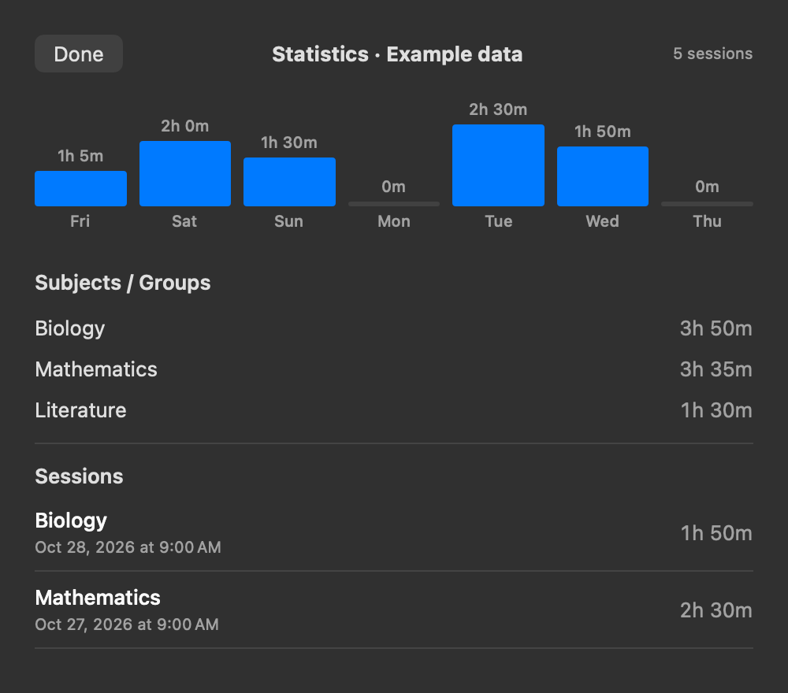

# SelfControl Tracker

A macOS companion for [SelfControl](https://selfcontrolapp.com/) with an optional Raycast extension. SelfControl blocks websites; the tracker records your sessions and their subjects on your Mac.

## Use

Start a block in SelfControl, then name its subject when prompted. Click the SelfControl icon in the menu bar and choose View Statistics to see your weekly chart and history. Use Groups in the popup or Raycast to create, rename, delete, or choose a color for groups. Weekly bars are split by group color. Renaming updates their sessions; deleting keeps the history without a subject. Raycast can also rename individual sessions.

The status dot is green above five minutes, amber in the last five, and red in the last minute. The helper starts at login, restarts if it exits, and opens the popup for new blocks. It has no Dock icon. Hover over a chart segment for that group’s time, or over a session to darken its group in the chart. Use the pencil and trash icons to edit groups, and expand Sessions for individual records.



The chart shows fictional sessions in a resized popup.

## Setup

The popup needs macOS, SelfControl, and the Apple command-line developer tools. Xcode is not required.

```sh
./scripts/install-helper.sh
```

The installer builds and ad-hoc signs the helper, adds a LaunchAgent, and restores the previous installation if startup fails.

For Raycast, install Raycast, Node.js 22.14 or later, and npm, then run:

```sh
npm install
npm run dev
```

After `npm run dev` builds the extension, press Ctrl-C. Raycast keeps the extension and may require you to sign in for development commands. Raycast can also start the helper if its LaunchAgent is registered.

To stop tracking until the next login, run `launchctl bootout gui/$(id -u)/local.focusledger.tracker`. To start it again, run `launchctl bootstrap gui/$(id -u) "$HOME/Library/LaunchAgents/local.focusledger.tracker.plist"`.

## Data and tests

History and groups stay in `~/Library/Application Support/Focus Ledger/`; the extension sends no session data to a server, and this repository contains no personal history. SelfControl does not provide a full session history or block start times. The helper records a start when it detects a block, usually within two seconds, and follows timer extensions. It cannot recover blocks missed while it was stopped. SelfControl updates may change its internal settings format.

Run `npm test`, `npm run typecheck`, and `npm run build` to check the extension. `scripts/install-helper.sh` runs a helper self-test. These tests do not start a real block.

## License

GPL-3.0-or-later; see [LICENSE](LICENSE). The icon comes from the [SelfControl source repository](https://github.com/SelfControlApp/selfcontrol). This project is independent of SelfControl and Raycast.
